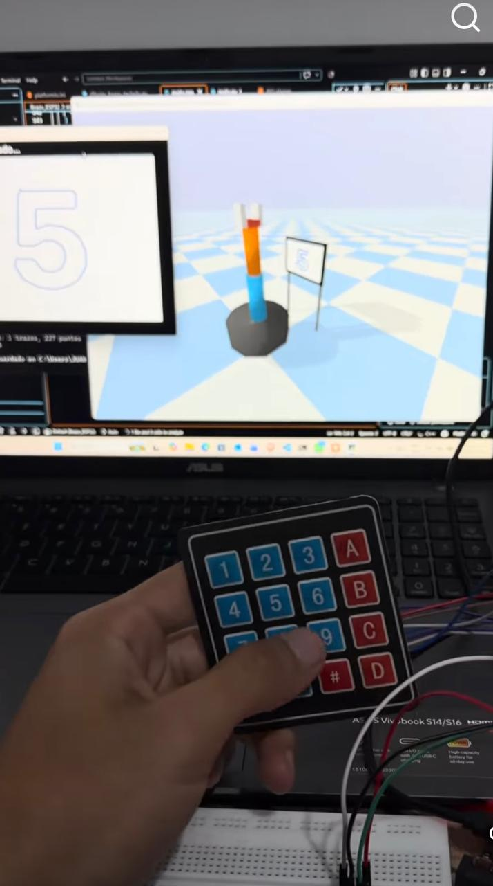
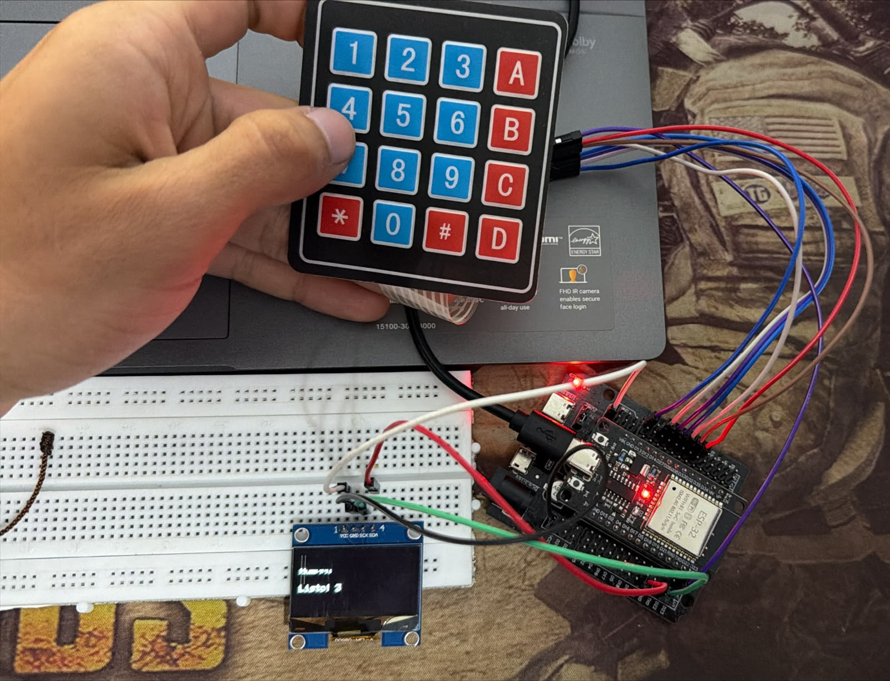
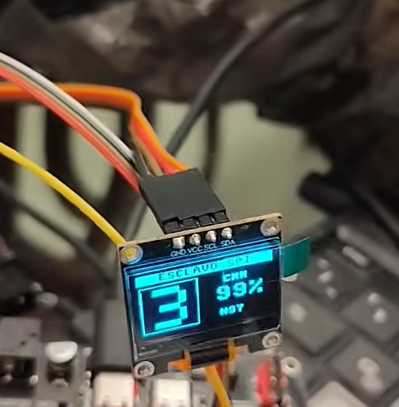

<div align="center">

# 🤖 Brazo Robótico en PyBullet controlado por ESP32

### Teclado matricial · Pantalla OLED · Comunicación SPI · Simulación de dibujo


</div>

---

## 📑 Contenido

- [Visión general](#-visión-general)
- [Estructura del repositorio](#-estructura-del-repositorio)
- [Parte 1: Teclado, OLED y brazo en PyBullet](#-parte-1-teclado-oled-y-brazo-en-pybullet)
- [Parte 2: Comunicación SPI entre dos ESP y pantalla OLED](#-parte-2-comunicación-spi-entre-dos-esp-y-pantalla-oled)
- [Solución de problemas](#-solución-de-problemas)
- [Autor](#-autor)

---

## 🧩 Visión general

Este repositorio reúne dos prácticas que integran microcontroladores ESP con software en el PC:

| Parte | Qué hace | Tecnologías |
| :---: | :--- | :--- |
| **1** | Un teclado matricial 4x4 y una OLED permiten ingresar un número; un brazo robótico simulado en PyBullet lo **dibuja** en una pizarra virtual. | ESP32, C++/PlatformIO, I2C, Python, PyBullet, OpenCV |
| **2** | Una ESP (maestro) recibe un dígito y su porcentaje de confianza desde el PC y lo transmite por **SPI** a una segunda ESP (esclavo), que lo muestra en una pantalla OLED. | ESP32 + MicroPython, SPI, I2C, SSD1306 |

---

## 📁 Estructura del repositorio

```text
TECLADO_I2C_-_SIMULACION_BRAZO_PYBULLET/
├── PARTE_1_TECLADO_BRAZO/            # (antes "ACTIVIDAD 6")
│   ├── platformio.ini
│   ├── src/main.cpp                  # Firmware ESP32: teclado + OLED SH1106
│   ├── dibujar_brazo_teclado.py      # Simulación y cinemática inversa
│   └── brazo.urdf                    # Modelo del brazo
│
├── PARTE_2_SPI_OLED/
│   ├── ESP_A_maestro/
│   │   └── main.py                   # Maestro SPI (MicroPython)
│   └── ESP_B_esclavo/
│       └── ssd1306.py                # Driver de la pantalla OLED
│
├── IMG/                              # Miniaturas, fotos de montaje y esquemas
└── README.md
```

---
---

# 🎹 Parte 1: Teclado, OLED y brazo en PyBullet

Este proyecto integra hardware (ESP32) y software de simulación (PyBullet) para controlar un brazo robótico capaz de **escribir números en una pizarra virtual**. Mediante un teclado matricial 4x4 y una pantalla OLED SH1106, el usuario ingresa un número, la ESP32 lo procesa y lo envía por puerto serial a un script en Python.

El script utiliza **OpenCV** para extraer los contornos del texto y **cinemática inversa** para que el modelo URDF del brazo dibuje el trayecto exacto en la simulación.

```text
 ┌──────────┐ I2C ┌─────────┐   Serial    ┌───────────────────────┐
 │ Teclado  ├────►│  ESP32  ├────────────►│ Python + OpenCV       │
 │ 4x4 +    │     │ (C++)   │ "NUM:123"   │ + cinemática inversa  │
 │ OLED     │◄────┤         │◄────────────┤ + PyBullet (URDF)     │
 └──────────┘     └─────────┘ "LCD:texto" └───────────────────────┘
```

## 🎥 Demostración

[](https://youtube.com/shorts/BWrsKaYS0Ik?si=BDTEaL4P9bpe0eT1)

> 💡 Haz clic en la imagen para ver el video.

## 📸 Montaje físico

[](IMG/MONTAJE.jpeg)

## 🛠️ Hardware

- **Microcontrolador:** ESP32 (ej. DOIT DevKit V1).
- **Pantalla:** OLED I2C de 1.3" (controlador SH1106, 4 pines: VCC, GND, SDA, SCK).
- **Teclado:** matricial 4x4 de membrana.
- Cables jumper y protoboard.

### Esquema de conexiones

| Componente | Pin físico | Pin ESP32 | Notas |
| :--- | :--- | :--- | :--- |
| **OLED SH1106** | VCC | 3.3V | Alimentación |
| **OLED SH1106** | GND | GND | Tierra |
| **OLED SH1106** | SDA | GPIO 21 | Bus I2C de datos |
| **OLED SH1106** | SCK / SCL | GPIO 22 | Bus I2C de reloj |
| **Teclado 4x4** | Filas (F1–F4) | GPIO 13, 14, 27, 26 | Salidas digitales |
| **Teclado 4x4** | Columnas (C1–C4) | GPIO 25, 33, 32, 23 | Entradas con pull-up |

## 💻 Software

### 1. Firmware de la ESP32 (C++ / PlatformIO)

Crea un proyecto en **PlatformIO** (VS Code) dentro de `PARTE_1_TECLADO_BRAZO/` con estos archivos:

**`platformio.ini`**

```ini
[env:esp32doit-devkit-v1]
platform = espressif32
board = esp32doit-devkit-v1
framework = arduino
monitor_speed = 115200
lib_deps =
    adafruit/Adafruit SH110X @ ^2.1.8
    adafruit/Adafruit GFX Library @ ^1.11.5
    chris--a/Keypad @ ^3.1.1
```

<details>
<summary><b>📄 <code>src/main.cpp</code> — clic para expandir el código completo</b></summary>

```cpp
#include <Arduino.h>
#include <Wire.h>
#include <Adafruit_GFX.h>
#include <Adafruit_SH110X.h>
#include <Keypad.h>

#define SCREEN_WIDTH 128
#define SCREEN_HEIGHT 64
#define OLED_RESET -1

Adafruit_SH1106G display = Adafruit_SH1106G(SCREEN_WIDTH, SCREEN_HEIGHT, &Wire, OLED_RESET);

const byte FILAS = 4;
const byte COLUMNAS = 4;
char teclas[FILAS][COLUMNAS] = {
  {'1','2','3','A'},
  {'4','5','6','B'},
  {'7','8','9','C'},
  {'*','0','#','D'}
};
byte pinesFilas[FILAS] = {13, 14, 27, 26};
byte pinesColumnas[COLUMNAS] = {25, 33, 32, 23};
Keypad teclado = Keypad(makeKeymap(teclas), pinesFilas, pinesColumnas, FILAS, COLUMNAS);

#define LED_PIN 2
const int MAX_CIFRAS = 4;
String numero = "";
String txt_estado = "#=Dibujar *=Borr";

void refrescarPantalla() {
  display.clearDisplay();
  display.setTextSize(1);
  display.setTextColor(SH110X_WHITE);
  display.setCursor(0, 15);
  display.print("Numero: ");
  display.print(numero);
  if (numero.length() < MAX_CIFRAS) display.print("_");
  display.setCursor(0, 35);
  display.print(txt_estado);
  display.display();
}

void actualizarEstado(String nuevoEstado) {
  txt_estado = nuevoEstado.substring(0, 16);
  refrescarPantalla();
}

void setup() {
  Serial.begin(115200);
  pinMode(LED_PIN, OUTPUT);
  Wire.begin(21, 22);
  delay(250);

  if(!display.begin(0x3C, true)) {
    Serial.println("Error al inicializar OLED SH1106.");
  } else {
    display.clearDisplay();
    display.display();
  }
  Serial.println("ESP32 lista: teclado + OLED SH1106 (C++)");
  refrescarPantalla();
}

void loop() {
  char tecla = teclado.getKey();
  if (tecla) {
    Serial.print("TECLA:"); Serial.println(tecla);
    digitalWrite(LED_PIN, HIGH); delay(40); digitalWrite(LED_PIN, LOW);

    if (isdigit(tecla)) {
      if (numero.length() < MAX_CIFRAS) { numero += tecla; refrescarPantalla(); }
      else { actualizarEstado("Max 4 cifras"); }
    }
    else if (tecla == '*') {
      if (numero.length() > 0) { numero.remove(numero.length() - 1); refrescarPantalla(); }
    }
    else if (tecla == '#') {
      if (numero.length() > 0) {
        Serial.print("NUM:"); Serial.println(numero);
        actualizarEstado("Enviado: " + numero);
        numero = ""; refrescarPantalla();
      } else { actualizarEstado("Escribe un num."); }
    }
    else if (tecla == 'A') { Serial.println("CMD:A"); actualizarEstado("Repitiendo..."); }
    else if (tecla == 'B') { Serial.println("CMD:B"); actualizarEstado("Borrando..."); }
    else if (tecla == 'C') { Serial.println("CMD:C"); actualizarEstado("Brazo a home"); }
    else if (tecla == 'D') { numero = ""; actualizarEstado("#=Dibujar *=Borr"); }
  }

  if (Serial.available() > 0) {
    String msg = Serial.readStringUntil('\n');
    msg.trim();
    if (msg.startsWith("LCD:")) { actualizarEstado(msg.substring(4)); }
  }
}
```

</details>

### 2. Simulación (Python + PyBullet)

Usa una versión de Python que tenga *wheels* precompilados de PyBullet (**recomendado Python 3.10 o 3.11**). Instala las dependencias:

```bash
pip install pybullet pyserial opencv-python numpy
```

Los archivos `dibujar_brazo_teclado.py` y `brazo.urdf` deben estar en la carpeta `PARTE_1_TECLADO_BRAZO/`.

## 🚀 Ejecución

1. **Carga el firmware** en la ESP32 con PlatformIO. Al terminar, **cierra el Monitor Serial** de VS Code para liberar el puerto COM.
2. **Identifica el puerto** asignado a la placa (por ejemplo `COM3` en Windows o `/dev/ttyUSB0` en Linux).
3. **Inicia la simulación** desde la carpeta de la Parte 1:

   ```bash
   cd PARTE_1_TECLADO_BRAZO
   python dibujar_brazo_teclado.py
   ```

## 🕹️ Controles del teclado

| Tecla | Acción |
| :---: | :--- |
| `0`–`9` | Digita el número a dibujar (hasta 4 cifras) |
| `#` | **Enviar y dibujar**: transmite el número a PyBullet |
| `*` | **Borrar carácter**: elimina la última cifra en la OLED |
| `A` | **Repetir** el último trazo enviado |
| `B` | **Borrar pizarra** en la simulación |
| `C` | **Home**: el brazo regresa a su posición de reposo |
| `D` | **Reset de pantalla**: limpia el texto y reinicia el número |

### Protocolo serial (ESP32 ↔ PC)

| Dirección | Mensaje | Significado |
| :---: | :--- | :--- |
| ESP32 → PC | `TECLA:x` | Tecla presionada |
| ESP32 → PC | `NUM:1234` | Número a dibujar |
| ESP32 → PC | `CMD:A` / `CMD:B` / `CMD:C` | Repetir / borrar / home |
| PC → ESP32 | `LCD:texto` | Texto de estado para mostrar en la OLED (máx. 16 caracteres) |

---
---

# 🔗 Parte 2: Comunicación SPI entre dos ESP y pantalla OLED

En esta parte, el PC envía por USB un **dígito detectado y su porcentaje de confianza** a una primera placa (**ESP-A, maestro SPI**). Esta empaqueta los datos en una trama con *checksum*, la transmite por **SPI** a una segunda placa (**ESP-B, esclavo**) y espera su confirmación (*ACK*). El esclavo muestra el resultado en una pantalla **OLED SSD1306**.

Ambas placas funcionan con **MicroPython**.

```text
 ┌──────┐  USB serial   ┌────────────┐      SPI       ┌────────────┐  I2C  ┌──────────┐
 │  PC  ├──────────────►│ ESP-A      ├───────────────►│ ESP-B      ├──────►│ OLED     │
 │      │ "DIG:7,95"    │ (maestro)  │ trama 5 bytes  │ (esclavo)  │       │ SSD1306  │
 │      │◄──────────────┤            │◄───────────────┤            │       │ 128x64   │
 └──────┘ "SPI:OK 7"    └────────────┘     ACK        └────────────┘       └──────────┘
```

## 🎥 Demostración

<!-- Reemplaza TU_ID_VIDEO_PARTE2 por el ID de tu video de YouTube (lo que va después de "v=" o de "/shorts/") -->

[](https://youtube.com/shorts/cFShk7gnTP0)

> 💡 Haz clic en la imagen para ver el sistema en funcionamiento.

## 📸 Montaje físico

<!-- Sube tu foto a IMG/ y descomenta la línea de abajo -->
<!-- [](IMG/MONTAJE_PARTE2.jpeg) -->

## 🛠️ Hardware

| Componente | Cantidad | Notas |
| :--- | :---: | :--- |
| Placa ESP con MicroPython (ESP-A, maestro) | 1 | Conectada al PC por USB |
| Placa ESP con MicroPython (ESP-B, esclavo) | 1 | Controla la OLED |
| Pantalla OLED SSD1306 I2C 128x64 | 1 | Dirección I2C por defecto `0x3C` |
| LED azul + resistencia (220 Ω – 330 Ω) | 1 | Indicador de envío en ESP-A |
| Cables jumper y protoboard | — | — |

> ℹ️ Los pines usados en el maestro (GPIO10–13) son habituales de un **ESP32-S3**. En un ESP32 clásico, GPIO10 y GPIO11 están reservados para la memoria flash y no se pueden usar: si usas esa placa, cambia los pines en `main.py`.

## 🔌 Conexiones

### Bus SPI (ESP-A → ESP-B)

| Señal | ESP-A (maestro) | ESP-B (esclavo) | Función |
| :--- | :---: | :---: | :--- |
| **SCK** | `GPIO 12` | `GPIO __` | Reloj SPI |
| **MOSI** | `GPIO 11` | `GPIO __` | Datos maestro → esclavo |
| **MISO** | `GPIO 13` | `GPIO __` | Datos esclavo → maestro (ACK) |
| **CS** | `GPIO 10` | `GPIO __` | Selección del esclavo (activo en bajo) |
| **GND** | `GND` | `GND` | **Tierra común obligatoria** |

### Otros componentes

| Componente | Pin del componente | Pin |
| :--- | :--- | :---: |
| LED de envío (ESP-A) | Ánodo (vía resistencia) | `GPIO 4` |
| OLED SSD1306 (ESP-B) | VCC | `3V3` |
| OLED SSD1306 (ESP-B) | GND | `GND` |
| OLED SSD1306 (ESP-B) | SDA | `GPIO __` |
| OLED SSD1306 (ESP-B) | SCL | `GPIO __` |

> ⚠️ Toda la lógica es de **3.3 V**. Conecta siempre el `GND` de ambas placas entre sí.

## 📡 Protocolo de comunicación

### 1. PC → ESP-A (USB serial, texto)

El PC envía una línea terminada en salto de línea:

| Mensaje | Significado |
| :--- | :--- |
| `DIG:7,95` | Dígito `7` detectado con 95 % de confianza |
| `DIG:-` | No se detectó ningún dígito |

La ESP-A responde al PC por el mismo puerto:

| Respuesta | Significado |
| :--- | :--- |
| `ESP-A lista: maestro SPI` | Mensaje de arranque |
| `SPI:OK 7` | El esclavo confirmó la recepción (ACK) |
| `SPI:ERROR 7` | El esclavo no respondió tras 3 intentos |
| `SPI:DATO INVALIDO ...` | La línea recibida no cumple el formato |

Reglas de validación: el dígito debe estar entre 0 y 9, y la confianza se limita a un máximo de 100.

### 2. ESP-A → ESP-B (SPI, trama de 5 bytes)

| Byte | Contenido | Valor |
| :---: | :--- | :--- |
| 0 | Inicio de trama | `0xA5` |
| 1 | Dígito | `0`–`9`, o `0xFF` si no hay dígito |
| 2 | Confianza | `0`–`100` (%) |
| 3 | Checksum | `0xA5 ^ dígito ^ confianza` (XOR) |
| 4 | Relleno / respuesta | El maestro envía `0x00`; el esclavo responde `0x06` (ACK) |

Códigos de control: `ACK = 0x06`, `NAK = 0x15`, `SIN_DIGITO = 0xFF`.

### 3. Parámetros del bus SPI

| Parámetro | Valor |
| :--- | :--- |
| Implementación | `SoftSPI` (por software) |
| Velocidad | **2 kHz** |
| Modo | 0 (`polarity=0`, `phase=0`) |
| Reintentos | 3, con 80 ms de espera entre cada uno |

> 💡 **¿Por qué 2 kHz?** MicroPython no incluye modo esclavo SPI por hardware, así que el esclavo lee cada bit por software. Un reloj lento le da tiempo de leer cada bit sin perderlos.

## 📂 Archivos anexos

| Archivo | Placa | Descripción |
| :--- | :---: | :--- |
| [`ESP_A_maestro/main.py`](PARTE_2_SPI_OLED/ESP_A_maestro/main.py) | ESP-A | Recibe `DIG:` por USB, arma la trama y la envía por SPI con reintentos |
| [`ESP_B_esclavo/ssd1306.py`](PARTE_2_SPI_OLED/ESP_B_esclavo/ssd1306.py) | ESP-B | Driver MicroPython para la pantalla OLED SSD1306 por I2C |

## 🚀 Puesta en marcha

### 1. Instalar MicroPython en ambas placas

Descarga el firmware de tu placa desde [micropython.org/download](https://micropython.org/download/) y cárgalo con `esptool`:

```bash
pip install esptool
esptool.py --chip esp32s3 --port COM5 erase_flash
esptool.py --chip esp32s3 --port COM5 write_flash -z 0x0 firmware.bin
```

> Cambia `esp32s3` por `esp32` si usas un ESP32 clásico (en ese caso la dirección de carga suele ser `0x1000`). Sigue siempre las instrucciones de la página de descarga de tu placa.

### 2. Copiar los archivos con `mpremote`

```bash
pip install mpremote

# ESP-A (maestro)
mpremote connect COM5 cp PARTE_2_SPI_OLED/ESP_A_maestro/main.py :main.py

# ESP-B (esclavo)
mpremote connect COM6 cp PARTE_2_SPI_OLED/ESP_B_esclavo/ssd1306.py :ssd1306.py
```

Cambia `COM5` y `COM6` por los puertos de tus placas. También puedes usar **Thonny** (*Guardar como → Dispositivo MicroPython*).

### 3. Probar la comunicación

1. Conecta el cableado SPI y alimenta ambas placas (**primero el esclavo**, luego el maestro).
2. Cierra Thonny o cualquier REPL abierto en el puerto de la ESP-A, porque solo un programa puede usarlo.
3. Abre un terminal serial sobre la ESP-A:

   ```bash
   python -m serial.tools.miniterm COM5 115200
   ```

4. Escribe `DIG:7,95` y presiona Enter. Debes ver `SPI:OK 7`, el LED parpadeará y la OLED del esclavo mostrará el dígito.

---

## 🩺 Solución de problemas

| Problema | Posible causa / solución |
| :--- | :--- |
| `SPI:ERROR` en la Parte 2 | El esclavo no devuelve ACK. Revisa el cableado SPI, que MISO esté conectado, el `GND` común y que el esclavo esté corriendo antes de enviar. |
| `SPI:DATO INVALIDO` | El formato debe ser exactamente `DIG:d,c` (dígito 0–9) o `DIG:-`. |
| La ESP-A no responde a los comandos | Thonny o `mpremote repl` tienen el puerto abierto. Ciérralos y vuelve a intentar. |
| La OLED de la Parte 2 está en blanco | Verifica SDA/SCL y la dirección I2C (`0x3C` o `0x3D`; usa `i2c.scan()`). |
| `pip install pybullet` falla (Parte 1) | Usa Python 3.10 o 3.11, o instala las [Build Tools de Visual Studio](https://visualstudio.microsoft.com/visual-cpp-build-tools/). |
| La OLED de la Parte 1 no inicia | Confirma GPIO21 (SDA) y GPIO22 (SCL), y que sea un controlador SH1106 (no SSD1306). |
| No aparece el puerto COM | Usa un cable USB con soporte de datos e instala el driver CP210x/CH340 si hace falta. |

---

## 👤 Autor

**JuanD001**

- GitHub: [@JuanD001](https://github.com/JuanD001)

---

<div align="center">

⭐ Si este proyecto te resultó útil, ¡considera darle una estrella en GitHub!

</div>
